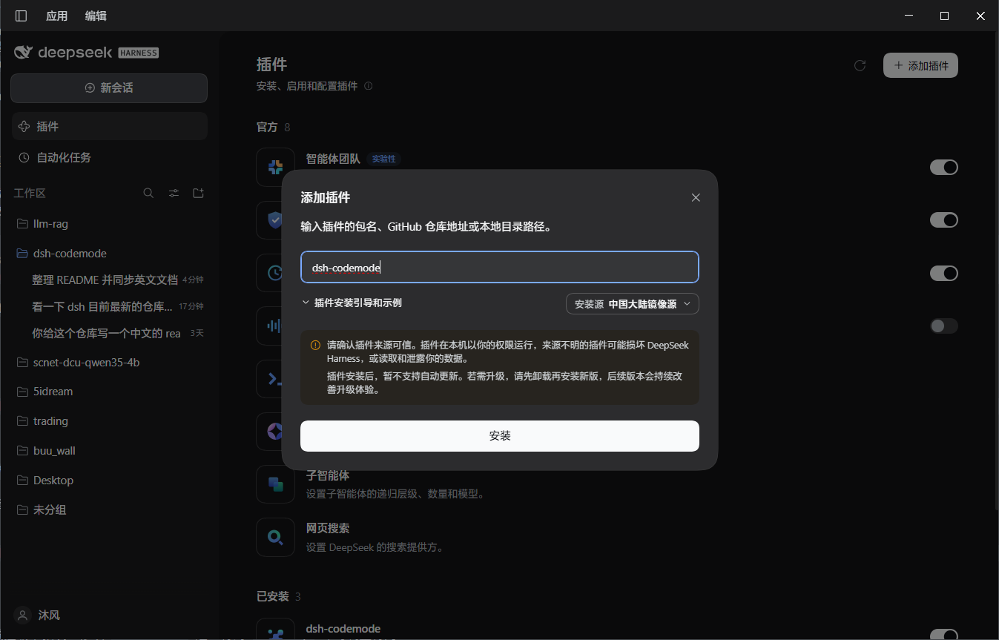

# dsh-codemode

[English](./README.en.md) | **简体中文**

一个面向 [DeepSeek Harness](https://github.com/deepseek-ai/deepseek-harness)（DSH）的
**Code Mode** 智能体预设：标准工具照常原生调用，**本预设清单以外的工具**（MCP 工具、
profile 级插件、按 agent 注册的工具集）被挡在**模型上下文之外**，只由一个额外的
`code_run` 工具从程序内部按需发现与调用。

设计上参考了 pi 的 codemode（`mode: on` + MCP 延迟暴露），但实现建立在 DSH 自带的 PTC 运行时之上，而不是另起一套沙箱。

## 它做了什么

为会话选择 `codemode` 模式后：

- **标准工具与标准模式一致**，原生直接调用，schema 不变。
- **本预设不拥有的工具一律不进上下文**，由程序内部发现和调用：
  ```js
  const { tools: hits } = await tools.code_tools_search({ query: 'okx ticker', limit: 5 })
  // hits[0].name、hits[0].description、hits[0].parameters（完整 JSON Schema）
  return await tools[hits[0].name]({ instId: 'BTC-USDT' })
  ```
  判定依据是**注册作用域**，不是名字前缀：本预设自身的插件行注册在预设作用域里，保持原生；
  MCP 服务端与 profile 级 bundle 注册在全局层，按 `agent.ctx` 注册的工具集（如 Agent Teams、
  定时任务）落在 agent 层，两者都被遮蔽。名字规则（`hiddenPrefixes`、`hiddenTools`、
  `nativeTools`）仍然生效，可用来加例外。
- 其他模式（`standard`、`ptc`、`minimal`、`cordis`）不受影响：那些模式下所有工具仍以原生方式呈现。

## 版本线

| 插件线 | 目标 DSH | 程序入口 |
|---|---|---|
| `0.2.x`（`main`） | 0.2.1-alpha.5 及以后 | 本包自带的 `code_run` 传输，预设行 `mode: native` |
| `0.1.x`（分支 `0.1.x`） | 0.2.0-rc.2 | 内置 `run_code`（由 `both` 附带），本包不注册传输 |

两条线行为一致：标准工具原生，预设自身清单以外的一切（MCP、profile 级插件、按 `agent.ctx`
注册的工具集）都只能从程序内部调用。`0.2.1` 已在真正的 0.2.1-alpha.5 内核上验证，口径与命令见
[docs/internals.md](./docs/internals.md#验证)。

## 安装


本地开发时改用 `link:` 指向检出目录即可：
```powershell
dsh plugin --profile desktop add "link:<path-to-the-checkout>"
```

## 配置

`cordis.patch.yml` 负责挂载本预设；修改 `codemode` 这一行的 `config` 即可调整行为
（`null` 或省略表示使用默认值）：

| 键 | 默认值 | 含义 |
|---|---|---|
| `nativeScope` | `true` | 遮蔽一切不是本预设自身作用域注册的工具（MCP、profile 级插件、按 agent 注册的工具集） |
| `hiddenPrefixes` | `['mcp__']` | 额外剥离的工具名前缀 |
| `nativeTools` | `[]` | 例外：这些名字始终原生呈现（`run_code` 与 `runToolName` 永远原生） |
| `hiddenTools` | `[]` | 例外：这些名字始终遮蔽 |
| `metaTools` | `[list, search, describe, debug]` | 发现工具名；第一个同时用作 codemode 标记 |
| `runToolName` | `code_run` | 本包传输工具的名称（不可用保留名 `run_code`） |
| `searchLimit` | `8` | `code_tools_search` 默认返回的行数 |
| `maxDescriptionChars` | `240` | 列表中描述文本的截断长度 |
| `maxParallelSubCalls` | `10` | 一个程序内可并发的只读子调用上限 |
| `guard` | `true` | 拒绝模型对被遮蔽工具的直接调用 |
| `sdkSection` | `true` | 注入 / 替换 Code Mode 说明段落 |
| `debug` | `true` | 注册 `code_debug` 工具 |

## 插件卸载

```powershell
dsh plugin --profile desktop remove dsh-codemode
```

预设行位于本 bundle 的 patch 层中，会随包一起消失。profile 之外的任何内容都未被改动。

## 限制

- **作用域判定依赖一处 DSH 内部结构。** 注册表没有公开「某个工具注册在哪个作用域」的 API，
  本包因此按符号描述 `dsh.scope` 读取 `@deepseek-ai/dsh-scope` 写在 scoped context 上的标签，
  再用公开的 `ctx.tools.get(name, scope)` 做归属判断（`lib/scope.js`）。读不到标签时（例如把本包
  挂在 host 层而不是预设里）作用域规则自动失效，只保留名字规则并打出一次 warn，不会误遮蔽。
  「注册表解析不出的名字」也保持原生——那是别的 prompt provider 贡献的 schema，谁也不拥有它，
  只遮蔽能确认归属的工具。
- **预设清单内的插件行算「标准」。** 判定是「本预设自己注册的」而不是「随 DSH 发布的」：
  往 `cordis.patch.yml` 的插件列表里加一行，它注册的工具就和标准工具一样保持原生；需要遮蔽时
  用 `hiddenTools`。反过来，只要插件挂在 profile（`dsh plugin add`），它的工具就在全局层或
  agent 层，会被自动遮蔽。
- **子调用调度是本包自己实现的。** 内置传输通过私有的 `TOOL_RUNTIME_SCHEDULER` 接入 agent
  loop 的调度器；本包改用公开的 `ctx.tools.executionMode()` 复刻同一份可观察契约
  （`exclusive` 串行成屏障、`parallel` 按 `maxParallelSubCalls` 限流）。差别在于：本包的池
  只对**同一程序内**的子调用排序，不与同一模型步中的其他工具调用互相排序。
- **不提供程序级沙箱升级。** 内置的 `sandbox_permissions` / `justification` 依赖模块私有的
  审批辅助函数，本包不暴露这两个参数；程序一律在标准策略下运行，而每个**子调用**仍各自走
  内置的策略与审批管线。
- **子调用不写会话日志。** `ctx.tools.execute()` 只发出 `tools/result` 事件；`tool/result` 会话条目
  由 agent loop 为它自己调度的调用写入，并没有订阅方会为程序内的子调用补写。内置传输会额外写
  `tool/ptc-dispatch` / `tool/ptc-dispatch-start` 配对事件，本包不写——因此一次程序运行不会留下
  可回放的子调用记录。
- 沙箱、超时上限与输出上限均由 PTC 运行时决定，与随包发布的 `ptc` 预设一致；`timeoutMs`
  由运行时钳制与计时，本包只负责转发。
- 若把 `persona` 配成 `complete: true`，`system-prompt` 会在瀑布之后恢复该完整段落，
  本包注入的 Code Mode 说明将被丢弃。默认配置不会触发。

## 开发文档

工作原理、常驻环境生命周期、验证与升级流程见 [docs/internals.md](./docs/internals.md)。
